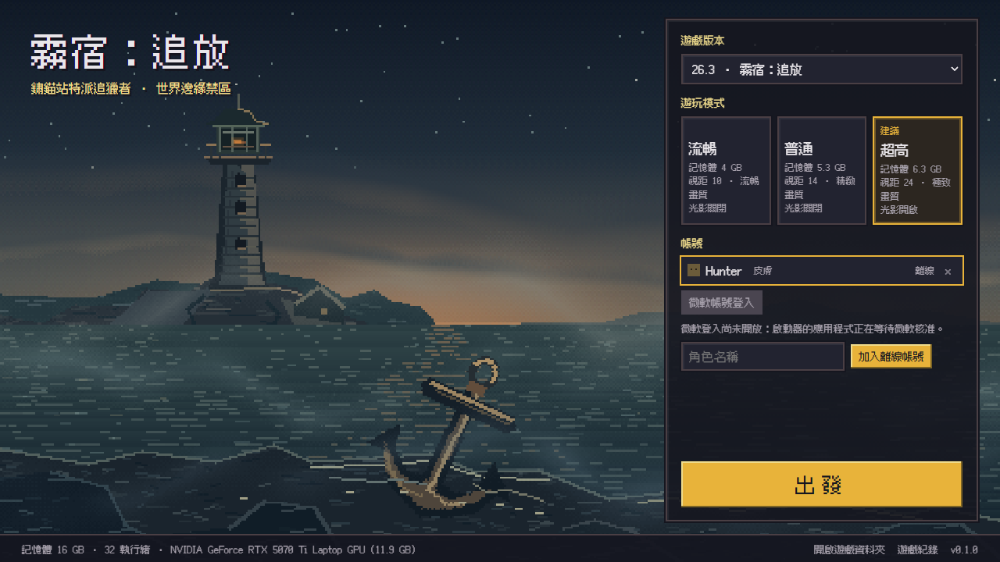

<div align="center">

**EN** | [繁中](../README.md)


# Mistinn Launcher

**A Minecraft launcher that gets everything ready for Mistinn: Exile.**

[](https://github.com/keeiv/mistinn-launcher/actions/workflows/ci.yml)
[](https://github.com/keeiv/mistinn-launcher/releases/latest)


[MoriTeahouse](https://moriteahouse.shizune.life) ·
[Mistinn: Exile](https://github.com/keeiv/mistinn-exile) ·
[Download](https://github.com/keeiv/mistinn-launcher/releases/latest) ·
[Contributing](CONTRIBUTING.en.md)

</div>

> **For now this is an offline launcher**: play with an offline account; Microsoft sign-in is not available yet.
> <sub>The author's application has not been approved.</sub>

Press **出發** (Go) and it downloads the game, Java, Fabric, Mistinn: Exile and a full set of performance mods, and tunes the settings to your computer.



The launcher's own interface is in Traditional Chinese.

## Download

Get the latest from [Releases](https://github.com/keeiv/mistinn-launcher/releases):

- `MistinnLauncher_<version>_x64-setup.exe`: installer.
- `MistinnLauncher_<version>_portable.exe`: no install, just run it.

Each build carries a copy of the Mistinn: Exile mod; its version is in the release title and tag (for example `v0.1.0-mod.0.1.0`). When [the mod](https://github.com/keeiv/mistinn-exile) releases, a launcher with the new mod built in follows within the hour.

The launcher is not code-signed, so Windows may first show "Windows protected your PC": choose **More info** → **Run anyway**.

## Three ways to play

The launcher reads your memory, CPU threads and graphics card (dedicated video memory through DXGI on Windows), works out values for each way to play, and marks the one it recommends.

|                                 | 流暢 Smooth             | 普通 Normal             | 超高 Ultra                                                          |
| ------------------------------- | ----------------------- | ----------------------- | ------------------------------------------------------------------- |
| Memory                          | about 1/4, at most 4 GB | about 1/3, at most 6 GB | about 2/5, at most 8 GB                                             |
| View distance (weak/mid/strong) | 6 / 8 / 10              | 8 / 12 / 14             | 12 / 16 / 24                                                        |
| Graphics                        | Fast                    | Fancy                   | Fabulous (Fancy on weak cards)                                      |
| Particles, clouds               | minimal, off            | decreased, fast         | all, fancy                                                          |
| Shaders                         | off                     | off                     | Iris and Complementary Reimagined with 6 GB of video memory or more |

- At least 3 GB is left to the system, and the game gets at least 2 GB.
- Simulation distance is capped by the number of CPU threads.
- Only these display settings are changed; everything else you set in the game (keys, volume, field of view) is kept.
- They are starting points, not a promise of a frame rate.

## Mods

Chosen after the popular Fabric performance packs (Fabulously Optimized and others). Each launch fetches the files for the chosen version from Modrinth and checks them by SHA-1.

- **Always**: Fabric API, Sodium, Sodium Extra, Reese's Sodium Options, Lithium, FerriteCore, ImmediatelyFast, EntityCulling, Dynamic FPS, More Culling, AppleSkin, Mod Menu.
- **Ultra (strong cards)**: Iris and the Complementary Reimagined shader pack.
- **Other versions (plain play)**: Xaero's Minimap, Xaero's World Map, Jade and Mouse Tweaks as well.
- **Mistinn: Exile (26.3)**: no extra minimap or inventory mods, since the mod has its own minimap and grid inventory.

A mod with no file for the chosen version is skipped and noted in the game log. The launcher only manages the mods it put there; files you put in `mods` yourself are never removed.

## Other versions

The version menu lists every full release. For anything other than 26.3 the launcher reminds you that **this version does not support Mistinn: Exile** and plays it plainly. Old versions Fabric does not support start as vanilla.

## Updates

At start the launcher asks GitHub for its latest release and compares it with the release and source commit it was built from. When a newer one is out, a small gold mark, **有新版本** (new version), appears by the version in the footer; it interrupts nothing. Clicking it opens the update window, which shows the current and the latest release and commit. **立即更新** (update now) downloads the new build, checks it against the SHA-256 GitHub records, replaces the running launcher and starts it again. Where the launcher's folder cannot be written (an install for every user), the new installer is started instead. No update runs while a game is starting.

Only builds downloaded from Releases look for updates; a build of your own never does. 0.1.0 does not have this yet: download 0.1.1 or later by hand once.

## Accounts

Type a player name and press **加入離線帳號** (add offline account) to play, with a skin of your own if you like. A name is 3 to 16 letters, digits or underscores.

Microsoft sign-in is written (the device code flow: the launcher never sees your password, and tokens are kept encrypted with Windows DPAPI), but it opens only once Microsoft approves the launcher for the Minecraft API; until then its button is disabled. How to apply: [microsoft-login.md](microsoft-login.md) (in Chinese).

## Where things are kept

Everything lives in a `.mistinn` folder in your Windows roaming application data folder: `versions`, `libraries`, `assets`, `runtimes` (Java) and `instances` (one game folder per version).

## Building

To work on the launcher, read the [contributing guide](CONTRIBUTING.en.md) first.

You need Rust (the MSVC toolchain), Node.js and the Visual Studio Build Tools. Run `npm ci` once to install the Tauri CLI.

```powershell
.\build.ps1 test      # unit tests
.\build.ps1 dev       # development mode
.\build.ps1 build     # the installer (NSIS)
```

On the first build, `build.ps1` runs `scripts/fetch-mod.ps1`, which downloads the jar to embed from the mod's latest release (checked against the SHA-256 GitHub records for it) into `src-tauri/resources/mods`. That folder is not under version control. To embed a given version: `.\scripts\fetch-mod.ps1 -Version 0.1.0`.

The background and icons come from the mod's title-screen art.

Self-test: `mistinn-launcher.exe --selftest <version> <smooth|normal|ultra> <player name> [mod jar]` installs and starts one game without opening the window; `--selftest-update` looks for, downloads, checks and swaps in the latest release without the window (and without restarting).

## License and thanks

- Pixel font: [Fusion Pixel Font](https://github.com/TakWolf/fusion-pixel-font), SIL Open Font License 1.1 (`src/assets/fonts/Fusion-Pixel-LICENSE.txt`).
- The mods are published on Modrinth by their authors; the launcher only downloads them on the player's computer and does not redistribute them.
- The launcher is licensed under the [GNU AGPL-3.0](../LICENSE), like the Mistinn: Exile mod.
